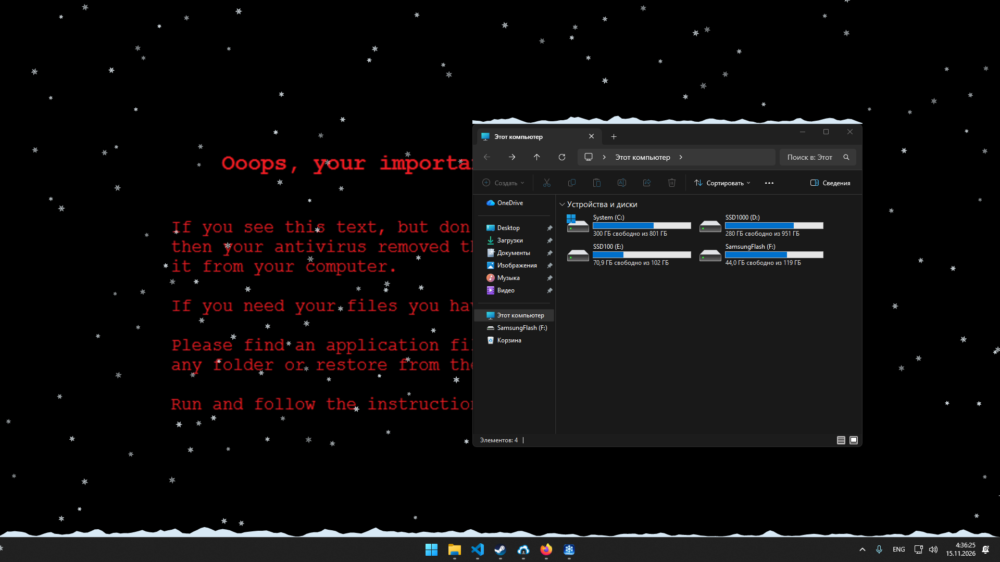

# ❄️ SnowVibe



Живой снег на рабочем столе Windows и macOS. Снежинки падают поверх экрана и собираются на окнах, панели задач или Dock.

## Возможности

- Четыре вида снега, настройка интенсивности и ветра.
- Накопление снега на окнах и панели задач и Dock.
- Снежные шары, снеговик и снегоуборщик.
- Быстрая очистка и пауза в полноэкранных приложениях.

## Скачать

Готовые версии в [Releases](https://github.com/bronoproblems/SnowVibe/releases).

Поддержка:
- **Windows 10/11 x64**
- **macOS 13+, Intel и Apple Silicon**

## Сборка

**Windows:**
```powershell
./Win/build.ps1
```

**macOS:**
```sh
zsh Mac/build.sh
```

Готовые файлы появятся в `Releases/`.
